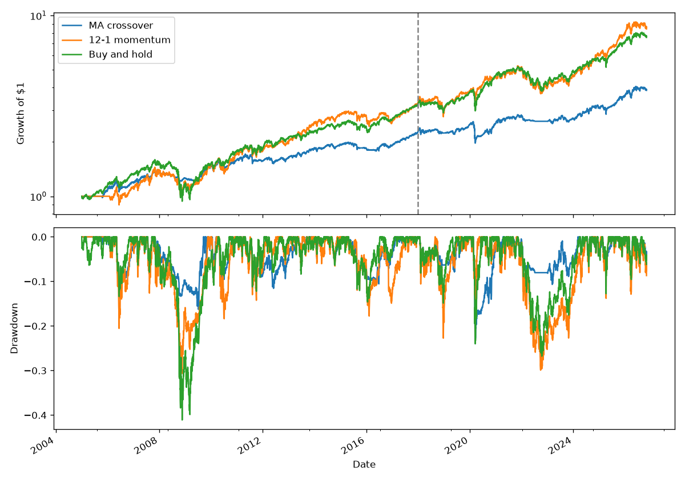

# Project 1: Momentum strategy backtest

From trading idea to tested strategy: fetch and clean historical prices, define
momentum signals and entry/exit rules, backtest without look-ahead bias, and
compare against buy and hold.

## Status

- [x] Data module: fetch, cache, clean (`src/qfp/data.py`)
- [x] Backtester with a one-day signal delay and transaction costs (`src/qfp/backtest.py`)
- [x] Metrics: CAGR, volatility, Sharpe, Sortino, max drawdown, hit rate, turnover (`src/qfp/metrics.py`)
- [x] Reference strategy: 50/200-day moving-average crossover (`strategy.py`)
- [x] Hypothesis
- [x] 12-1 momentum (`strategy.momentum_12_1`) with tests
- [x] Robustness checks: lookbacks, crisis periods, Sharpe confidence intervals (`robustness.py`)
- [x] Results and limitations write-up

## 1. Hypothesis

- **Claim.** A 50/200-day moving-average crossover on 7 ETFs (SPY, QQQ, IWM, EFA, EEM, TLT, GLD), 1/7 each with cash when the signal is off, beats buy and hold of the same ETFs on a risk-adjusted basis, after 5 bps trading costs.
- **Why.** News spreads slowly and investors herd, so prices trend. Bear markets like 2008 and 2022 unfold over months, so a slow signal can step aside in time.
- **Test.** Sharpe ratio and max drawdown, in sample (2005–2017) and out of sample (2018 onward).
- **Reject if** out-of-sample Sharpe is below buy and hold, or max drawdown is not at least 30% smaller.

_Note: written after a first exploratory run of the MA strategy. The 12-1 momentum variant was added afterwards as a second test._

## 2. Data

Daily adjusted closes for liquid ETFs (`run.py`, `TICKERS`) from 2005, via
yfinance, cached in `data/cache/`. Cleaning: drop tickers with under 95% coverage,
forward-fill gaps of up to 5 days (never backward-fill), and flag one-day moves
over 30% for inspection.

Known bias: the universe is chosen with today's knowledge (survivorship bias).

## 3. Rules

| | MA crossover | 12-1 momentum |
|---|---|---|
| Signal | 50-day MA above 200-day MA | Return from t−252 to t−21 |
| Entry | Signal turns on | Asset enters the top N at month end |
| Exit | Signal turns off | Asset drops out of the top N |
| Sizing | Equal weight across all assets, cash when off | Equal weight across the top N |
| Rebalance | Daily | Monthly |
| Costs | 5 bps per unit traded | 5 bps per unit traded |

## 4. Avoiding look-ahead bias

Signals at date t use prices up to the close of t; the backtester trades them
from t+1 (`signal.shift(1)`). `tests/test_backtest.py` and
`tests/test_strategy.py` check that changing future prices never changes past
returns or signals.

## 5. Results

`python projects/01_momentum_backtest/run.py` (5 bps costs, signals traded the day after they are computed).

| | MA 50/200 | 12-1 momentum (top 3) | Buy and hold |
|---|---|---|---|
| **In sample (2005–2017)** | | | |
| CAGR | 6.5% | 9.5% | 9.4% |
| Volatility | 9.5% | 14.8% | 15.5% |
| Sharpe | 0.71 | 0.69 | 0.66 |
| Max drawdown | −16% | −31% | −41% |
| **Out of sample (2018–)** | | | |
| CAGR | 6.2% | 11.4% | 10.2% |
| Volatility | 11.2% | 16.3% | 14.6% |
| Sharpe | 0.60 | 0.74 | 0.74 |
| Max drawdown | −24% | −30% | −27% |
| Annual turnover | 1.3 | 3.6 | 0.0 |

**Verdict on the hypothesis: rejected.** Out of sample the MA crossover's Sharpe (0.60) is below buy and hold (0.74), and its drawdown is only 11% smaller (−24% vs −27%), not 30%.

**What the strategies actually do:**
- **MA crossover is a risk filter, not a return engine.** It cut the in-sample drawdown from −41% to −16% by sitting in cash in 2008, but gave up about 3% a year in return.
- **12-1 momentum matches buy and hold.** Its Sharpe is the same out of sample (0.742 vs 0.738) with a different path: smaller losses in 2008, larger in 2022.
- **Costs are not the issue.** Annual cost drag ≈ turnover × 5 bps: about 0.07% (MA) and 0.18% (momentum).

## 6. Robustness and limitations

`python projects/01_momentum_backtest/robustness.py`

**Parameter sensitivity (out-of-sample Sharpe).**
- MA windows: 20/100 → 0.76, 50/200 → 0.60, 100/300 → 0.69. All have smaller drawdowns than buy and hold, none clearly beats it on Sharpe. The risk-reduction result is stable; the Sharpe result is not.
- Momentum: 0.45 to 0.79 across 12 settings. 6- and 9-month lookbacks mostly lose to buy and hold; holding only the top 1 asset is the worst everywhere (too concentrated).
- **Overfitting warning:** the best in-sample momentum setting (9 months, top 3: Sharpe 0.82) was one of the weaker ones out of sample (0.58). Choosing parameters on in-sample Sharpe would have backfired.

**Crisis periods (total return).**

| | MA 50/200 | 12-1 momentum | Buy and hold |
|---|---|---|---|
| 2008 crisis (Jan 2008 – Mar 2009) | −10% | −22% | −38% |
| Covid crash (Feb – Mar 2020) | −22% | −12% | −23% |
| 2022 bear (Jan – Oct 2022) | −7% | −28% | −25% |

The MA filter works in **slow** bear markets (2008, 2022) and fails in a **fast** crash (2020): a 200-day average cannot react within five weeks. Momentum did worse than buy and hold in 2022, when stocks and bonds fell together and last year's winners reversed.

**Statistical significance.** Out-of-sample Sharpe 95% confidence intervals (SE ≈ √((1 + SR²/2)/years), about 8 years): MA 0.60 [−0.12, 1.31], momentum 0.74 [0.00, 1.49], buy and hold 0.74 [−0.01, 1.48]. The intervals overlap almost completely, so **no strategy is distinguishable from buy and hold on Sharpe.**

**Limitations.**
- Only 7 ETFs, chosen with hindsight (survivorship bias); momentum is usually tested on hundreds of assets.
- Cash earns 0% in the backtest; in 2023–24 cash paid ~4–5%, which would help the MA strategy.
- Costs are a flat 5 bps; no slippage, taxes or bid–ask widening in crises.
- One fixed split (2018), not a full walk-forward test.

**Conclusion.** On this universe, simple trend signals do not beat buy and hold on risk-adjusted return. Their real value is **drawdown control in slow bear markets**, at the cost of lower returns and no protection in fast crashes. Next steps: a larger universe, combining momentum with the MA filter, and walk-forward parameter selection.
