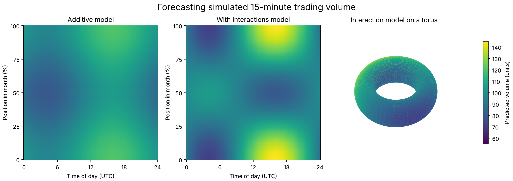

# Project 4: Doughnut surface for trading-volume forecasts

Forecast 15-minute trading volume from two repeating clocks: **time of day**
(wraps at midnight UTC) and **position in the calendar month** (wraps at the
month boundary). Each cycle is encoded with sine and cosine so 23:45 sits next
to 00:00 and the 31st next to the 1st. Together the two phases form a torus.

Same idea as Project 2's calendar phase, now with two clocks and their interaction.

## Status

- [x] Simulation proof of concept (`torus_volume.py`)
- [x] Real-data script for BTC 15-minute volume (`crypto_volume.py`, Binance public data)
- [x] Baseline (20-day slot average), harmonics k = 1..3, weekday and yesterday's level
- [x] Run on real data, with ablations
- [x] Results and limitations write-up

## Simulation results

Ordinary least squares, fitted on 2024 (35,136 intervals), tested on Jan–Jun
2025 (17,376 intervals). Volume is simulated with a fixed seed.

| Model | Features | Test RMSE (volume units) |
|---|---|---|
| Additive | Intercept + daily (cos, sin) + monthly (cos, sin) | 14.43 |
| With interactions | Additive + 4 products of daily × monthly sine/cosine | 8.00 |

The interaction model cuts test RMSE by 44.6%. The simulation builds in a
reversal at 16:00 UTC: volume is higher at that hour near the turn of the month
and lower mid-month. Only the interaction terms can represent that, and their
error matches the simulated noise standard deviation (8 units), the best
any model can do.

Left: additive model. Middle: model with interactions. Right: the middle
heatmap wrapped onto a doughnut (time of day around the ring, position in the
month around the tube).

**Caveat:** the simulated volume is generated from exactly the interaction
model's functional form, so this shows the method *can* recover such a pattern,
not that real markets have one. That is what the real-data step tests.

## Run

    python projects/04_torus_volume/torus_volume.py

Prints the results and saves `torus_volume.png` next to the script.

## Real data: BTC 15-minute volume

    python projects/04_torus_volume/crypto_volume.py

Downloads monthly BTCUSDT 15-minute klines from Binance's public archive
(2021-01 to 2025-06, cached in `data/cache/binance/`), models log quote volume,
trains on 2021–2023 and tests on 2024 onward. Compares four models: the 20-day
slot average, torus additive, torus + interactions, and torus + interactions +
weekday + yesterday's volume level. Prints RMSE on log volume and mean absolute
percentage error, and saves `crypto_volume.png` (actual vs fitted grid).

### Results (BTCUSDT, train 2021–2023, test 2024 to June 2025, 52,512 bars)

| Model | RMSE (log volume) |
|---|---|
| Slot average, 20 days (industry baseline) | 0.804 |
| Torus additive | 0.868 |
| Torus + interactions (the doughnut) | 0.868 |
| Torus + interactions + weekday + yesterday's level | 0.703 |
| **Day waves + weekday + yesterday's level (no month cycle)** | **0.703** |
| Torus additive + weekday + yesterday's level | 0.703 |
| Slot-average shape + yesterday's level | 0.793 |

(Mean absolute % error follows the same ranking but is inflated by a few
extreme spikes, so RMSE on log volume is the main metric.)

**What the ablation shows**

- **The month cycle and the day × month interactions add nothing on real BTC volume** (0.7032 without them vs 0.7033 with them). The turn-of-the-month reversal built into the simulation does not exist here.
- **The gain over the baseline (−12.5% RMSE) comes from three simple things:** a smooth daily shape (3 harmonics), the day of the week (crypto weekends are quieter), and yesterday's volume level (volume is persistent: busy days follow busy days).
- **A fixed shape alone loses to the baseline** (0.868 vs 0.804) because BTC's volume level drifts strongly. Any forecast needs a level term.
- **A smooth shape beats the raw slot average** even when both get yesterday's level (0.703 vs 0.793): 20 noisy daily observations per slot overfit, while a few harmonics fitted on 3 years average the noise out.

**Conclusion.** The doughnut is a neat way to encode two clocks and works when the
interaction exists (simulation). On real BTC data only the daily clock matters.
The winning model is simple: daily waves + weekday + yesterday's level,
12.5% better than the standard volume-curve baseline.

**Limitations.** One asset and one exchange; a fixed train/test split rather
than monthly walk-forward refits; the level term only uses the previous day
(adding the last hour's volume would help for short-horizon forecasts);
no event flags yet (macro releases, options expiry, ETF flows).

## Plan for real data (original)

1. **Data.** Crypto (e.g. BTC-USDT spot) has years of free 15-minute bars and
   trades 24/7, so the UTC time-of-day clock covers the full circle. For
   equities, yfinance gives 15-minute bars for only ~60 days (hourly for ~2
   years); use the exchange's local time, not UTC, because daylight saving
   moves the US open between 13:30 and 14:30 UTC.
2. **Target.** Model log volume: volume is skewed and multiplicative, and
   errors are then in percent.
3. **Baselines to beat.** (a) Same slot's average over the last 20 days, the
   standard "volume curve" used by execution desks; (b) yesterday's volume in
   the same slot.
4. **More features.** Higher harmonics (k = 2, 3) for the sharp open/close
   spikes; day of week; recent volume level (volume is persistent);
   event flags: month-end and index rebalances, options expiry (3rd Friday),
   FOMC and CPI days.
5. **Evaluation.** Walk-forward (refit monthly, predict the next month), RMSE
   and MAPE on log volume, compared with the baselines.

Why it matters: execution algorithms (VWAP) split large orders in proportion
to forecast volume, so better intraday volume curves mean lower trading costs.
